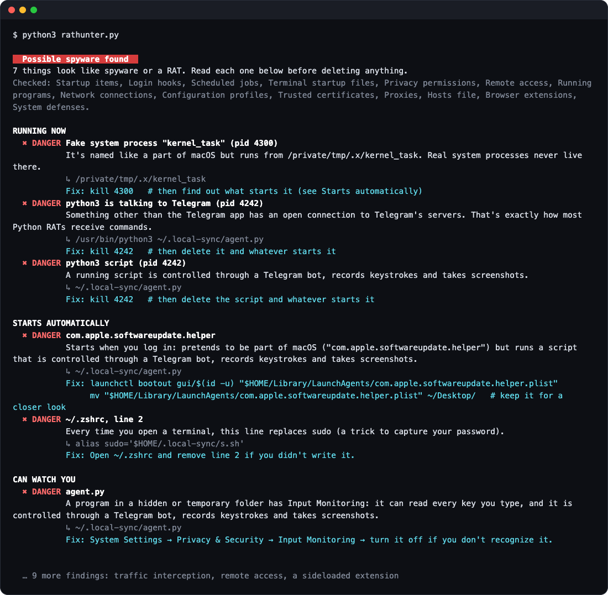
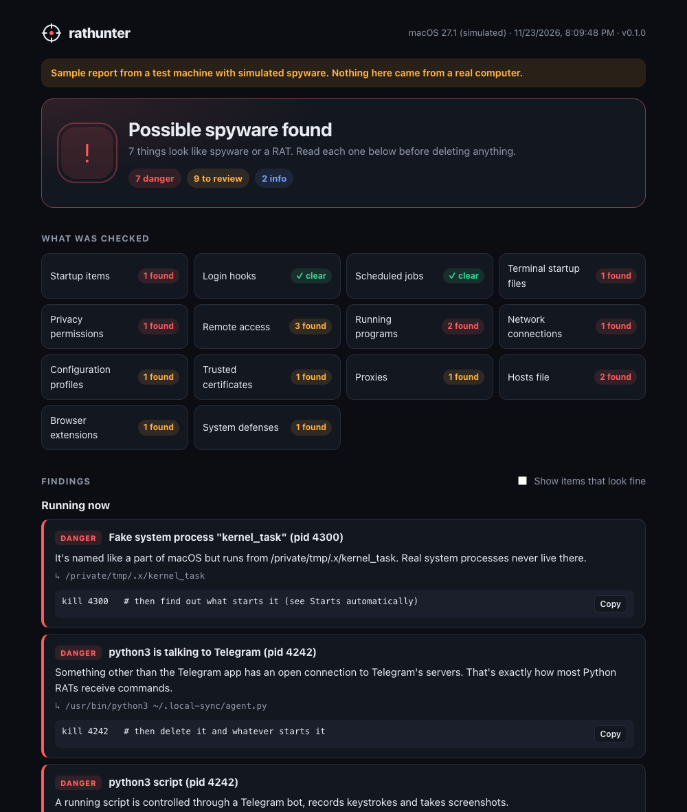

<div align="center">

# rathunter

**Is someone spying on your Mac? Find RATs, stalkerware and spyware in 1 second, explained in plain English.**

One command. Read-only. Nothing uploaded. Zero dependencies.

[](https://github.com/annapurnageeks/rathunter/actions/workflows/ci.yml)
[](#run-it)
[](#run-it)
[](rathunter.py)
[](#what-it-will-never-do)
[](SKILL.md)
[](LICENSE)



**[▶ See a full sample report](https://annapurnageeks.github.io/rathunter/)** (from a test machine with simulated spyware)

</div>

---

## Run it

```bash
git clone https://github.com/annapurnageeks/rathunter
python3 rathunter/rathunter.py
```

That's it. Python 3.9+ ships with the Xcode command line tools. Nothing to install, no account, no API key.

Want the visual report?

```bash
python3 rathunter/rathunter.py --html report.html --open
```



> **For the full check, give your terminal Full Disk Access** (System Settings → Privacy & Security → Full Disk Access). Without it, macOS won't let any tool read which apps can record your screen or keyboard. rathunter tells you when it had to skip something. It never shows a skipped check as "clear".

## Why I built this

I learn security by building both sides. I wrote [a Python RAT for macOS](https://github.com/annapurnageeks/RAT-for-MAC) for research: a few hundred lines that take screenshots, use the webcam and answer to a Telegram bot. It's scary how little it takes.

So I wrote the tool that catches it. Pointed at that RAT's source, rathunter flags it as *controlled through a Telegram bot, takes screenshots, uses the webcam and steals saved passwords*. Installed on a Mac, it would also be caught by how it starts at login, what it's allowed to see, and who it's talking to.

## What it checks

Everything an incident responder would look at first, in about a second:

| | What rathunter looks for |
|---|---|
| 🔁 **Starts by itself** | Launch agents and daemons (and who signed them), items **pretending to be Apple**, scripts hidden in dot-folders or `/tmp`, login hooks, cron jobs, and lines in `.zshrc`/`.bash_profile` that download code or **replace `sudo` to steal your password** |
| 👁️ **Can watch you** | Programs allowed to **read your keyboard**, **record your screen**, control your Mac, or use the camera and microphone, with extra alarm when it's a script in a hidden folder |
| 🚪 **Can reach in** | Remote Login, Screen Sharing and other open doors; SSH keys that can log in as you; remote-control apps (AnyDesk, TeamViewer, RustDesk…) installed or running |
| 🏃 **Running now** | **Fake system processes** (a `kernel_task` running from `/tmp`), unsigned programs in hidden folders, and scripts **talking to Telegram's servers**, the control channel of most hobby RATs |
| 🕵️ **Can read your traffic** | Configuration profiles (a classic stalkerware trick), **trusted root certificates** that let someone read HTTPS, proxies, and `/etc/hosts` lines that send your bank to a fake site or block security sites |
| 🧩 **Browser extensions** | Sideloaded extensions (Chrome, Brave, Edge, Arc, Vivaldi, Opera) that can read every site and your cookies |
| 🛡️ **Your defenses** | System Integrity Protection, Gatekeeper, FileVault, firewall, system extensions |

Every finding says **what it is, why it matters, and how to fix it**, with a command you can copy. Things you probably set up yourself (Zoom's screen recording, a debugging proxy's certificate) are labelled that way, so the scary ones stand out.

### How it decides

- **Danger** means it looks like malware: a script with RAT behaviour (Telegram or Discord control, keylogging, screenshots, webcam, password theft, download-and-run), something disguised as Apple, an unsigned program running from a hidden or temporary folder, or a hosts file redirecting a bank.
- **Review** means it can be abused, but is often legit: remote access turned on, a configuration profile, a trusted certificate, a sideloaded extension.
- **Info** means it's fine: startup items signed by known developers, apps you gave permissions to.

The rules are plain Python in [`rathunter.py`](rathunter.py). Read them, argue with them, improve them.

**Tested on a real remote-controlled Mac.** CI runs rathunter on GitHub's macOS build machines, which really are remote-controlled computers. It correctly reports SSH on, SIP off, and provisioning scripts holding Accessibility, Screen Recording and Full Disk Access, all as **review**, with zero false **danger** alarms. ([See the latest run](https://github.com/annapurnageeks/rathunter/actions/workflows/ci.yml).)

## What it will never do

- **Change anything.** It only reads. The fixes are suggestions you run yourself.
- **Upload anything.** No network requests at all. The report is one local HTML file.
- **Reveal your username.** Paths in your home folder are shown as `~`, so reports are safe to share when asking for help.

## Let an AI investigate with you

rathunter is also an [agent skill](https://docs.claude.com/en/docs/claude-code/skills). Install it for Claude Code:

```bash
git clone https://github.com/annapurnageeks/rathunter ~/.claude/skills/rathunter
```

Then ask *"check my Mac for spyware"*. The agent runs the scan, digs into anything suspicious (reads the script, checks the signature, finds what launches it), explains it to you, and helps you clean up. It **asks before removing anything**.

## Options

```
python3 rathunter.py [options]

  --all          also show items that looked fine
  --html FILE    write a visual report
  --open         open the report in your browser
  --json         print results as JSON (for scripts and agents)
  --no-color     plain text
```

Exit codes: `0` clean, `1` something to review, `2` possible spyware. Handy for scripts and fleet checks.

## Honest limits

rathunter is a fast, transparent first look, **not an antivirus**. It finds the common ways spyware and RATs persist, watch and phone home on macOS. A careful, targeted attacker (a kernel-level rootkit, or a nation-state implant like Pegasus) can hide from any tool running on the same machine. If you think you're being targeted by someone with those resources, get help from a professional or from [Access Now's Digital Security Helpline](https://www.accessnow.org/help/).

Found a false alarm, or spyware it missed? Please [open an issue](https://github.com/annapurnageeks/rathunter/issues). Real-world samples (with personal data removed) make the rules better.

## Roadmap

- [ ] Windows (registry run keys, scheduled tasks, services, WMI subscriptions)
- [ ] Linux (systemd units, cron, `ld.so.preload`, shell startup files)
- [ ] Known stalkerware signatures from public indicator lists
- [ ] Optional `--deep` mode with `sudo` for root-only items

## Contributing

Run the tests with `python3 -m unittest discover tests`. They use a **simulated infected Mac** ([`tests/simulated.py`](tests/simulated.py)) built from harmless text files and canned command output, so you can add a detection without real malware.

Also by me: **[commit-wrapped](https://github.com/annapurnageeks/commit-wrapped)** (your year in code) and **[gitumentary](https://github.com/annapurnageeks/gitumentary)** (a documentary of any repo's history).

## License

[MIT](LICENSE)
